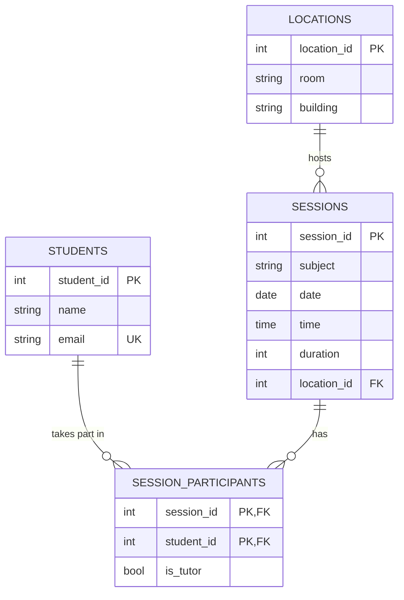

# Tutoring Session Manager

A web app for scheduling and reporting on peer tutoring sessions, built for Purdue's CS 348 (Information Systems). Tutors and tutees are students; each session has a subject, time, duration, location, one tutor, and any number of tutees. The app runs on Flask and SQLAlchemy over a MySQL database hosted on Google Cloud SQL.

## Features

- **Create, edit, and delete sessions**, assigning a tutor, tutees, and a location to each.
- **Session reports** for a chosen tutor and date range, optionally filtered by location: each session's tutee count, plus totals and averages for number of sessions, duration, and tutees.

## Database design



- **Normalized schema.** Students, sessions, and locations are separate tables. `session_participants` is a junction table with a composite primary key `(session_id, student_id)` and an `is_tutor` flag, so one table handles both roles and a student can tutor in one session and be tutored in another.
- **Indexes for the report query.** Composite indexes on `sessions(date, location_id)` and `session_participants(session_id, is_tutor)`, plus single-column indexes on `sessions.date`, `sessions.location_id`, and `session_participants.student_id`, support filtering by date range and location and the lookups by tutor.
- **Parameterized SQL.** The report is a hand-written query that joins `session_participants` twice (once for the tutor, once to count tutees), filters by date range, tutor, and optional location, and aggregates with `GROUP BY`. All user inputs are passed as bound parameters to prevent SQL injection.

## Tech stack

Python, Flask, SQLAlchemy, MySQL (Google Cloud SQL), Google App Engine, Gunicorn

## Running locally

```sh
python -m venv venv
source venv/bin/activate
pip install -r requirements.txt

export DB_USER=... DB_PASS=... DB_NAME=tutoring_db DB_HOST=...
flask --app app run
```

## Deploying to App Engine

1. Copy `env_variables.yaml.example` to `env_variables.yaml` and fill in your database credentials. This file is git-ignored.
2. Set `cloud_sql_instances` in `app.yaml` to your Cloud SQL instance.
3. Run `gcloud app deploy`.
